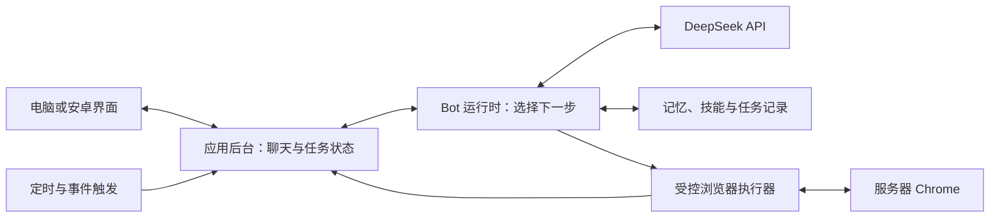

# Grok Bot 机制与 DeepSeek Bot 项目方案

更新：2026-10-31（Asia/Shanghai）。

本文保留开发前的调研与设计。当前代码、IP部署和完成程度以项目 README 及 [第一版验收记录](./第一版验收记录.md) 为准。

本轮依据 Grok Bot 官方产品文档、浏览器工具官方源码与文档，并通过 SSH 只读检查现有浏览器服务。没有登录 Grok 账号，没有安装或升级服务器软件，没有让模型执行网页任务。本文件区分官方公开行为、已检查的环境和我们拟采用的实现。

## 目标与范围修订

目标是制作个人使用、由 DeepSeek 驱动的 Grok Bot 类助手：有长期身份的多个 Bot，在云端使用浏览器和文件完成任务，支持后台工作、主动联系、定时执行及 Bot 交接，电脑与安卓访问同一份状态。

**服务器浏览器是第一版核心能力。** 先前“不操作电脑”的范围现在明确为“不控制用户本机”；服务器上的浏览器操作纳入第一版。任意服务器终端执行、完整云桌面和本机控制不作为第一版默认能力。

## 从官方资料确认的产品机制

| 官方公开行为 | 对本项目的影响 | 官方来源 |
|---|---|---|
| 命名 Bot 长期承担职责；主 Bot 主动联系并协调其他 Bot | 身份和任务归属必须持续存在 | [创建和管理 Bot](https://docs.x.ai/grok-bot/bots#your-primary-bot) |
| 每个 Bot 保有自己的记忆，少量个人事实共享；记忆可纠正、忘记 | 区分角色记忆、共享资料与原始聊天 | [Bot 记忆](https://docs.x.ai/grok-bot/bots#what-a-bot-remembers) |
| 同账号 Bot 共用云电脑、文件和浏览器登录；关闭客户端仍可工作 | 任务由服务器持有，登录跨任务保留 | [电脑和应用](https://docs.x.ai/grok-bot/computer-and-apps) |
| 用户能看执行过程、接管人工步骤、追加指令或停止任务 | 界面需要工具过程、等待状态和接管入口 | [电脑预览](https://docs.x.ai/grok-bot/computer-and-apps#watch-computer-work)、[工作中改变方向](https://docs.x.ai/grok-bot/chat-and-collaboration#redirect-work-in-progress) |
| Bot 能在群聊协调，也能异步向另一 Bot 交接 | 需要可追踪的派工与结果返回 | [群聊与交接](https://docs.x.ai/grok-bot/chat-and-collaboration#let-bots-hand-work-off) |
| Skill 保存方法，routine 保存时间或事件触发；有运行历史 | 技能说明与调度计划分开保存 | [技能与例行任务](https://docs.x.ai/grok-bot/skills-routines-and-automations) |

官方[安全架构页](https://docs.x.ai/grok-bot/security#architecture)还公开了客户端、服务器、托管计算机、模型服务和应用连接之间的关系。这不等于公开了它使用的具体 Agent 框架、数据库、调度器或浏览器自动化库。本项目下面的工具循环、队列和数据表均是我们的实现选择。

## 核心执行流程

工具循环为：读取任务和上下文 → 模型选择动作 → 后台检查动作 → 执行浏览器工具 → 将页面结果交回模型 → 继续或结束 → 验证并保存成果。

模型生成“我要点击”不是点击证据。界面中的执行步骤必须由工具返回值产生；完成任务应有真实页面、来源链接、保存文件或经过检查的结果。

[DeepSeek Tool Calls](https://api-docs.deepseek.com/zh-cn/guides/tool_calls/)明确工具实际由调用方执行。当前[图像理解文档](https://api-docs.deepseek.com/zh-cn/guides/vision/)列出 `deepseek-flash` 的图片输入，因此可评估网页文字/结构为主、截图理解为辅的路线；模型最终能力仍需实际任务验证。

## 第一版应具备的体验

| 能力 | 第一版行为 |
|---|---|
| 联系人式多 Bot | 可设名字、头像、职责，选择主 Bot；职责与长期偏好可以通过聊天更新 |
| 记忆 | 各 Bot 的事实和工作摘要分别保存；共享基本个人资料；支持查看、修改和删除 |
| 云浏览器 | 打开链接、读页面、点击、输入、滚动、管理标签、截图、下载；上传仅访问用户为该任务选定的文件 |
| 持久会话 | 专用浏览器配置目录保存登录状态；到期或需要人工验证时显示等待状态 |
| 任务过程 | 显示当前网页、操作与结果；支持停止、追加指令、人工接管和恢复 |
| 后台任务 | 用户关闭网页不终止任务；重新打开能补齐进度和结果；重启时区分可恢复与需重新观察的步骤 |
| 群聊交接 | 支持 @、主 Bot 派给其他 Bot、返回成果；交接次数、工具步数和时长有限制 |
| 主动和定时 | 一次提醒、周期任务、按约定主动联系；保存时区、下次运行与运行历史 |
| 技能 | 成功流程可保存成可编辑的步骤、输入和验证说明；例行任务引用技能版本 |
| 结果与通知 | 返回来源、文件或明确失败原因；区分消息已保存与手机实际通知到达 |

任意终端、完整桌面、多个屏幕并行、示范录制自动生成技能、语音通话、广泛第三方连接器及多人共享可以后续扩展。

## 浏览器与任务如何协调

先以一个专用浏览器、少量标签页、一次一个浏览器交互任务验证现有 2 核 2 GB 机器。Bot 的模型请求可以单独调度，使用浏览器时领取控制权，避免同时点击或修改同一页面。

各 Bot 可以共享账号级登录；每次动作仍绑定任务、Bot 和标签页，私有记忆不能因为共用浏览器就全部混合。不同标签页不是 Cookie 或权限隔离。

用户选择接管后，后台停止向该页面下达动作；用户结束接管时重新读取页面，再继续后续步骤。预览与输入通过登录后的应用后台转发，Chrome 控制端口不直接向公网开放。

优先提供有限的浏览器动作接口，不把模型生成的整段 shell 命令当浏览器工具执行。网页内容作为外部资料，不能成为新增权限或覆盖用户要求的来源。外发、购买、删除等动作按用户已经授权的任务范围检查，范围不明时展示具体动作与参数；已经明确授权的同一动作不反复询问。

凭据、模型密钥保留在后台或专门登录流程，不写入普通聊天、记忆或工具日志。浏览器进程使用独立的低权限运行身份；应用数据、浏览器配置和文件工作区分开保存。正式部署应明确浏览器可访问的网络范围，防止网页影响服务器控制接口。

这些是本项目的执行边界设计；不能仅靠性格提示词要求模型自觉遵守，也不声称复制了 Grok 的内部审核机制。

## 浏览器接入环境与验证边界

开发前在一台 Ubuntu 22.04、2核2GB的试验服务器上检查了既有 headless Chrome。CDP 控制接口仅监听回环地址；配置目录可保存登录状态。现有服务名称或同名辅助脚本不能作为已安装某个开源 Agent 框架的证据。

正式实现使用本项目独立的浏览器服务和配置目录，不接管其他服务的登录状态与标签页。具体实现见 `botapp/browser.py` 与 `deploy/deepseek-bot-browser.service`；真实任务、持久化和接管验证以第一版验收记录为准。

## 开源复用方向修订

上一轮 SillyTavern、RisuAI、Open WebUI 仍可参考界面、角色与聊天，但选择整个系统基础时，要优先评估常驻 Agent 运行时和浏览器执行能力。

### OpenClaw：新增完整运行时候选

[OpenClaw](https://github.com/openclaw/openclaw) 的官方资料已有[多 Agent 路由](https://docs.openclaw.ai/concepts/multi-agent)、[持久自动任务](https://docs.openclaw.ai/automation/cron-jobs)、[受控浏览器](https://docs.openclaw.ai/tools/browser)和 [DeepSeek 提供方](https://docs.openclaw.ai/providers/deepseek)，功能方向更贴近本次明确的目标。它是完整运行时候选，尚不能据此认定符合我们的联系人 UI、私有部署和资源要求。

仓库快照：`main`，`1bdc2908bce9c23766307aee629c006062b16af2`，最近提交 UTC 2026-10-30。[许可证](https://github.com/openclaw/openclaw/blob/1bdc2908bce9c23766307aee629c006062b16af2/LICENSE)为 MIT；所查 [package.json](https://github.com/openclaw/openclaw/blob/1bdc2908bce9c23766307aee629c006062b16af2/package.json)版本为 `2026.10.9`，要求 Node `>=24.16.0 <25 || >=26.1.0`，现有服务器 Node 12 不满足。这里只读调研，没有运行其安装器、引入默认宿主工具权限或升级服务器运行时。

### 浏览器执行层

| 工具 | 定位与可复用部分 | 接入边界 |
|---|---|---|
| [Vercel agent-browser](https://github.com/vercel-labs/agent-browser) | 浏览器命令执行层；支持 CDP、页面结构与元素引用、点击输入、截图、会话保存和预览/输入协议 | 我们的 Bot 运行时统一决定动作；不把它的独立聊天模式作为第二套人格系统。与服务器同名状态脚本区分 |
| [browser-use](https://github.com/browser-use/browser-use) | 包含观察、规划、执行的浏览器 Agent 框架；有官方 DeepSeek 适配、无视觉示例和 CDP 接入 | 如引入，要让其子任务、暂停、预算和状态服从外层 Bot 任务；不能出现两个不受控循环 |
| [Playwright](https://github.com/microsoft/playwright) | 可直接控制浏览器的自动化库，适合实现确定的动作与验证 | 需要我们提供模型工具映射；CDP 连接和原生 Playwright 连接的能力并不完全相同 |

源码与许可锚点：

- agent-browser：`768853dc6a23a42fbe0e939b6a02b706614723aa`，Apache-2.0；[CDP 与标签固定](https://github.com/vercel-labs/agent-browser/blob/768853dc6a23a42fbe0e939b6a02b706614723aa/docs/content/docs/cdp-mode.mdx)、[预览与输入协议](https://github.com/vercel-labs/agent-browser/blob/768853dc6a23a42fbe0e939b6a02b706614723aa/docs/content/docs/streaming.mdx)、[安全机制](https://github.com/vercel-labs/agent-browser/blob/768853dc6a23a42fbe0e939b6a02b706614723aa/docs/content/docs/security.mdx)。当前主分支是 Rust 原生 CLI/daemon，与旧教程的 Node/Playwright 路径有差异。
- browser-use：`b49a68e4060acb226da8f784194fef301c53a6d7`，MIT；[DeepSeek 示例](https://github.com/browser-use/browser-use/blob/b49a68e4060acb226da8f784194fef301c53a6d7/examples/models/deepseek-chat.py)、[DeepSeek 实现](https://github.com/browser-use/browser-use/blob/b49a68e4060acb226da8f784194fef301c53a6d7/browser_use/llm/deepseek/chat.py)、[CDP 示例](https://github.com/browser-use/browser-use/blob/b49a68e4060acb226da8f784194fef301c53a6d7/examples/browser/using_cdp.py)。示例中的模型名仍需按接入时的官方 API 配置。
- Playwright：`eac236da288cdc3d0891278a61e1a876348950a0`，Apache-2.0；[CDP 文档](https://github.com/microsoft/playwright/blob/eac236da288cdc3d0891278a61e1a876348950a0/docs/src/api/class-browsertype.md#async-method-browsertypeconnectovercdp)、[登录状态](https://github.com/microsoft/playwright/blob/eac236da288cdc3d0891278a61e1a876348950a0/docs/src/auth.md)。

一个实际兼容性问题：所查 agent-browser 的 `--allowed-domains` 要求受控的新上下文，拒绝已有 CDP、profile 或 restore 等路径。不能宣称连接现有 `9222` 的同时，已用这个开关实现全部网络隔离。内容边界标记和 BrowserContext 同样不等于服务器安全沙盒。

另一个适配边界：所查 browser-use 的 [Agent 实现](https://github.com/browser-use/browser-use/blob/b49a68e4060acb226da8f784194fef301c53a6d7/browser_use/agent/service.py#L476)检测到模型名含 `deepseek` 后，会强制设为 `use_vision=False`。DeepSeek 官方模型支持图片，不代表这个版本的框架已经自动适配截图理解；截图辅助路线仍需单独验证或调整适配层。

目前保留两条可验证路线：OpenClaw 作为运行时加定制界面；或独立轻量运行时搭配浏览器执行适配器。选择依赖本地原型的状态管理、可控性、DeepSeek 工具兼容和服务器资源测试，不因功能清单直接定案。AstrBot 的任务持久化、Shikigami 的主动发言限制和 SillyTavern 的群聊仍可分别参考。

## 用真实流程验收目标

示例需求：“每天晚上八点打开指定网站，检查有没有新通知；有变化就整理来源发给我，没变化不打扰。”

应实际贯通：保存例行任务和时区 → 到时启动指定 Bot → 打开服务器浏览器 → 读取页面并记录来源 → 与上次结果比较 → 保存结果 → 按变化决定通知 → 记录本次状态。

还需检查：关闭客户端不停止、重启恢复、登录失效时等待接管、执行中停止、Bot 交接不重复操作、失败不冒报完成、重试不重复提交外部动作。现阶段这些都是待验证要求，尚未实现。
